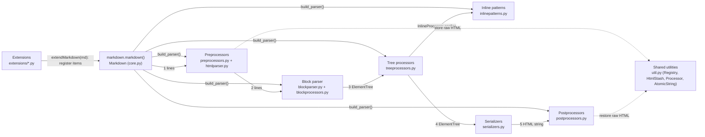

# Python-Markdown — Architecture

This document describes how the `markdown` package is put together at commit
`b41e0aaf1181f1a8cb200cf5a815aad7c0020d23` (tag 3.11.2): the main components and
how they call each other, three architectural decisions, and the rules a change
should follow. Paths are relative to the repository root.

## 1. Overview

Python-Markdown converts a Unicode Markdown string into an HTML string. It runs a
fixed pipeline of five stages. Each stage is an ordered collection of small
processor objects. The `Markdown` class builds the pipeline, lets extensions add
to it, and then runs the stages in order. Between the block stage and the
serializer the document is an `xml.etree.ElementTree` tree. Before that stage it
is a list of lines. After serialization it is a single string.

| # | Component | Files | What it does | Calls / is called by |
|---|-----------|-------|--------------|----------------------|
| 1 | **Core / public API** | `markdown/__init__.py`, `markdown/core.py`, `markdown/__main__.py` (CLI) | `Markdown` class. `build_parser()` creates every stage by calling the module-level `build_*` factory functions. `registerExtensions()` / `build_extension()` load extensions. `convert()` runs the stages in order. `reset()` clears per-document state. `markdown()` and `markdownFromFile()` are thin wrappers. | Calls every stage factory and every stage at convert time. Called by users and the CLI. |
| 2 | **Preprocessors** | `markdown/preprocessors.py`, `markdown/htmlparser.py` | Work on the list of source lines. `NormalizeWhitespace` normalises line endings and tabs. `HtmlBlockPreprocessor` uses `HTMLExtractor` to cut raw HTML blocks out and replace them with placeholders. | Run by `Markdown.convert()`. Write into `md.htmlStash`. |
| 3 | **Block parser** | `markdown/blockparser.py`, `markdown/blockprocessors.py` | `BlockParser` splits the text on blank lines and, for each block, asks each `BlockProcessor` in priority order `test()`; the first that accepts it `run()`s and appends elements to the tree. Built-ins: empty (100), list-indent (90), code (80), hash header (70), setext header (60), hr (50), ordered list (40), unordered list (30), quote (20), reference (15), paragraph (10). | Called by `convert()` via `md.parser.parseDocument()`. Processors call back into `parser.parseChunk()` / `parseBlocks()` for nested content. |
| 4 | **Tree processors** | `markdown/treeprocessors.py` | Each `Treeprocessor.run(root)` mutates (or replaces) the tree. Defaults: `InlineProcessor` (`inline`, priority 20), `PrettifyTreeprocessor` (`prettify`, 10), `UnescapeTreeprocessor` (`unescape`, 0). Higher priority runs first. | Run by `convert()`. `InlineProcessor` calls the inline-pattern registry. |
| 5 | **Inline patterns** | `markdown/inlinepatterns.py` | Regex-driven `InlineProcessor` objects whose `handleMatch(m, data)` returns `(element_or_text, start, end)`. Backticks (190), escapes (180), references (170), links (160), images (150), autolinks, line breaks, inline HTML, entities. Emphasis is handled by `DelimiterProcessor` (`em_strong`, 60), stored on `md.delimiters`. | Called only by `treeprocessors.InlineProcessor`. |
| 6 | **Serializers + postprocessors** | `markdown/serializers.py`, `markdown/postprocessors.py` | `to_html_string` / `to_xhtml_string` turn the tree into text (attributes sorted; boolean attributes minimised in `html`; empty tags use ` />` in `xhtml`). Postprocessors then work on the string: `RawHtmlPostprocessor` (30) swaps placeholders back for stashed HTML, `AndSubstitutePostprocessor` (20) restores `&`. | Serializer chosen by `set_output_format()`. Both run by `convert()`. Postprocessors read `md.htmlStash`. |
| 7 | **Shared utilities** | `markdown/util.py` | `Registry` (named, priority-sorted collection used by every stage), `Processor` base class, `HtmlStash`, placeholder constants (`STX`/`ETX`, `HTML_PLACEHOLDER`, `INLINE_PLACEHOLDER`), `AtomicString`, `parseBoolValue`, `get_installed_extensions()`. | Imported by the stage modules that share registries and placeholders. `serializers.py` does not import it. |
| 8 | **Extensions** | `markdown/extensions/__init__.py` (base `Extension`), `markdown/extensions/*.py` | Each extension subclasses `Extension`, keeps its options in `config`, and in `extendMarkdown(md)` registers its own processors into the registries (and may deregister or replace built-ins). Built-ins: abbr, admonition, attr_list, codehilite, def_list, extra, fenced_code, footnotes, legacy_attrs, legacy_em, md_in_html, meta, nl2br, sane_lists, smarty, tables, toc, wikilinks. | Loaded by `Markdown.registerExtensions()`. Extensions import core stage modules. Core stage modules do not import extensions. |

**Typical call sequence for `markdown.markdown(text, extensions=['toc'])`:**
`Markdown.__init__` → `build_parser()` (default registries) → `registerExtensions()` →
`build_extension('toc')` resolves the entry point → `TocExtension.extendMarkdown(md)` registers a
tree processor at priority 5 → `set_output_format('xhtml')` → `reset()`. Then `convert()`:
preprocessors → `parser.parseDocument()` → tree processors (inline patterns run inside the `inline` tree processor, before `toc`) →
serializer → strip the `
` wrapper → postprocessors → return string.

`attr_list` is a tree processor at priority 8, so it runs before `toc` (5) and can set an `id` that `toc` must not overwrite. `footnotes` registers a block processor (17), an inline pattern (175), and several tree processors (50, 19, 15) because one feature has to collect definitions, render markers, and then fix duplicate backlinks after inlines have run.

**Tests.** `tests/` uses `unittest`. Most syntax tests subclass
`markdown.test_tools.TestCase` and call `assertMarkdownRenders(source, expected, **kwargs)`.
Run them with `python -m unittest discover tests`.

## 2. Architecture Decision Records

### ADR-1: Every pipeline stage is a named, priority-sorted `Registry`

- **Status:** Verified. Commit `6ee07d2` ("Replace homegrown OrderedDict with purpose-built Registry"). `Registry.register` states that a higher number runs first.
- **Context:** Extensions need to insert processors between built-in ones (for example the footnote inline pattern must run before reference links), and to remove or replace built-ins. The earlier design used a home-grown `OrderedDict` with string positions such as `"<reference"`.
- **Decision:** All preprocessors, block processors, inline patterns, tree processors and postprocessors live in a `util.Registry`. Items are added with `register(item, name, priority)`. Higher priority runs first. Registering an existing name replaces the old item. `deregister(name)` removes one. Iterating the registry yields items in priority order.
- **Alternatives considered:** Keep the `OrderedDict` with relative-position strings; plain Python lists that extensions index into; a hard-coded pipeline subclass per feature set.
- **Consequences:** Extensions only need to know the names and priorities of the items they position against. Priorities are part of the de-facto public API, so changing a built-in priority can silently reorder extensions.

### ADR-2: Extensions are classes loaded by entry-point name or dotted path

- **Status:** Verified. Commit `cd73243` ("Refactor Extension loading"). The lookup order is the docstring of `Markdown.build_extension`.
- **Context:** Users want to enable extensions by short names such as `'toc'`. Previously short names were special-cased to modules inside `markdown.extensions` or modules named `mdx_*`.
- **Decision:** An extension is an instance of a subclass of `markdown.extensions.Extension` that overrides `extendMarkdown(md)`. A string name is resolved by `build_extension()`: first as an entry point in the `markdown.extensions` group, then as dotted notation `path.to.module:Class`, and finally `path.to.module` with a module-level `makeExtension(**kwargs)` factory. Built-in extensions are registered as entry points in `pyproject.toml` exactly like third-party ones. Options are keyword arguments checked against the extension's `config` dict (`{'key': [default, 'description']}`).
- **Alternatives considered:** Keep special-casing `markdown.extensions.*` / `mdx_*` names; require users to always pass class instances; a central registry dict inside core.
- **Consequences:** Built-in and third-party extensions are loaded the same way, and core never imports a specific extension. A new built-in extension needs both a module with `makeExtension` and an entry point in `pyproject.toml`. Short names work only after the package is installed so the entry-point metadata exists.

### ADR-3: Raw HTML is stashed behind placeholders and restored after serialization

- **Status:** Verified. The `HtmlStash` docstring says HTML is extracted at the start and put back in place of placeholders. The alternatives below are Inferred: no commit or comment records them.
- **Context:** The document is held as an ElementTree whose text is escaped by the serializer. Raw HTML written by the author must reach the output unchanged and must not be parsed as Markdown.
- **Decision:** Raw HTML is removed early and stored in `md.htmlStash`. A placeholder built from the `STX`/`ETX` control characters is left in the text. After serialization, `RawHtmlPostprocessor` replaces each placeholder with the stored HTML. Text that later inline patterns must not process is wrapped in `util.AtomicString`.
- **Alternatives considered:** Parse raw HTML into the ElementTree (a later serializer would rewrite the author's markup); leave raw HTML in element text (the serializer would escape it).
- **Consequences:** Any stage can inject finished HTML with `md.htmlStash.store()` and the returned placeholder. `NormalizeWhitespace` strips `STX`/`ETX` from input so placeholders cannot be forged. The stash is cleared in `Markdown.reset()`. Code that reads element text (for example `toc` building labels) must tolerate placeholders.

## 3. Constraints

| # | Rule | Where it can be seen |
|---|------|----------------------|
| C1 | **Add processors only through the registries.** New behaviour is a subclass of `Preprocessor`, `BlockProcessor`, `inlinepatterns.InlineProcessor`, `Treeprocessor`, or `Postprocessor`, registered with `register(item, name, priority)` on `md.preprocessors`, `md.parser.blockprocessors`, `md.inlinePatterns`, `md.treeprocessors`, or `md.postprocessors`. Optional features do not edit `build_*` or `Markdown.convert()`. | `markdown/util.py` (`Registry.register`), `markdown/core.py` (`build_parser`, `convert`), `markdown/extensions/abbr.py` |
| C2 | **Extensions follow the `Extension` contract.** Subclass `markdown.extensions.Extension`, declare options as `self.config = {'key': [default, 'description']}` before `super().__init__(**kwargs)`, read them with `getConfig()` / `getConfigs()`, override `extendMarkdown(md)`, and provide `makeExtension(**kwargs)`. A built-in also gets an entry point under `[project.entry-points.'markdown.extensions']` in `pyproject.toml`. | `markdown/extensions/__init__.py`, `markdown/extensions/wikilinks.py`, `pyproject.toml` |
| C3 | **Dependencies point from extensions to core, never back.** The core stage modules (`preprocessors.py`, `blockparser.py`, `blockprocessors.py`, `treeprocessors.py`, `inlinepatterns.py`, `serializers.py`, `postprocessors.py`, `util.py`, `htmlparser.py`) do not import `markdown.extensions`. `core.py` and `markdown/__init__.py` import only the `Extension` base class. | imports at the top of `markdown/core.py`, `markdown/__init__.py`, and `markdown/extensions/*.py` |
| C4 | **Per-document state must be reset.** A processor that keeps state exposes `reset()` and the extension calls `md.registerExtension(self)` in `extendMarkdown`, so `Markdown.reset()` clears it before the next document. | `markdown/core.py` (`registerExtension`, `reset`), `markdown/extensions/footnotes.py`, `markdown/extensions/toc.py` |
| C5 | **Do not put raw HTML into element text.** The serializer escapes text. Build elements, or store finished HTML with `md.htmlStash.store()` and insert the placeholder. Wrap text that later inline patterns must not touch in `util.AtomicString`. The package has no third-party runtime dependencies. | `markdown/util.py`, `markdown/serializers.py`, `pyproject.toml` |
